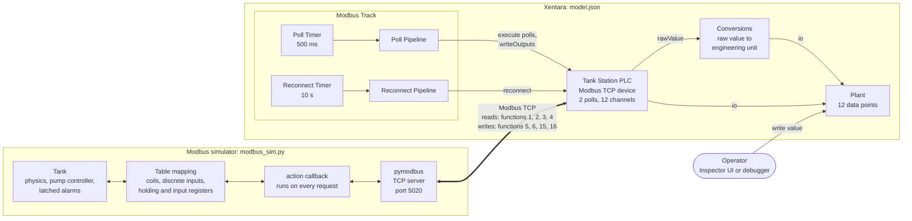
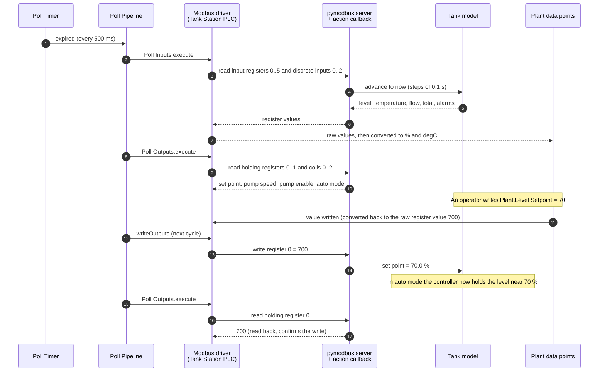
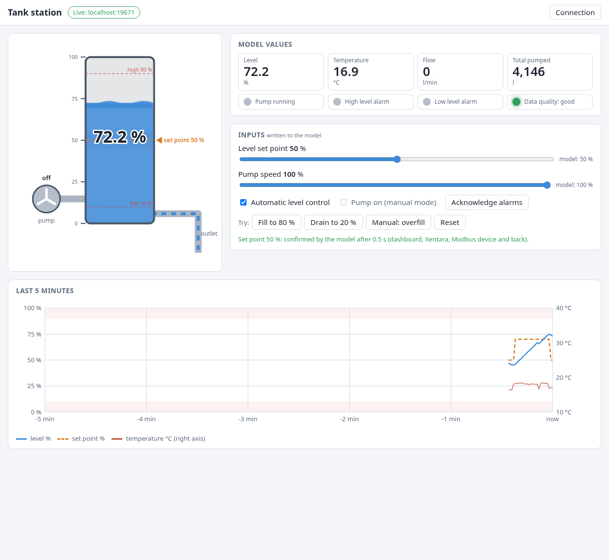

# Xentara lab: UBI 10 container + simulated Modbus hardware

A Xentara container based on Red Hat UBI 10, a simulated Modbus TCP device (a water-tank station with a pump), and a realistic Xentara model that reads and controls it.

```
xentara-lab/
  container/Containerfile    Xentara on UBI 10 (build stage: Debian 12 + alien, runtime stage: UBI 10)
  container/entrypoint.sh    creates a TLS certificate when the HTTP server is configured, then runs xentara
  simulator/modbus_sim.py    Modbus TCP simulator (Python + pymodbus; also requirements.txt, Containerfile, tests)
  model/make_plant_model.py  generates model/modbus-plant.json (stable UUIDs)
  model/modbus-plant.json    the Xentara model (device address 127.0.0.1:5020)
  dashboard/                 web dashboard of the model (HTML/JS, no build) + container image (nginx on UBI 10)
  lab.sh                     builds and runs everything with podman
```

> **Unofficial.** Xentara is only published as Debian packages; the image contains them converted to RPMs. embedded ocean GmbH does not officially support this. The image contains proprietary software: do not push it to a public registry.

## How it fits together

Xentara acts as the Modbus client and polls the simulated device over Modbus TCP. Inside the simulator, a plain-Python tank model is exposed through four Modbus tables; inside Xentara, the model turns raw registers into process data points.



One poll cycle and one write, step by step:



## Dashboard: see the effect of changing the inputs

[`dashboard/`](dashboard/README.md) is a web page that shows the model live (tank with water level, set point and controller band, pump, flow, temperature, alarms, a 5 minute trend) and lets you change the inputs: set point, pump speed, automatic or manual control, pump on, acknowledge alarms. It talks directly from the browser to Xentara's WebSocket interface, like the Xentara Inspector, so every change goes through the whole chain and the page shows how long the model took to confirm it (about half a second).



```bash
podman build --format docker -t xentara-dashboard -f dashboard/Containerfile dashboard
podman run -d --name xentara-dashboard -p 8091:8080 xentara-dashboard        # http://<host>:8091
```

`./lab.sh up` starts it with the rest of the lab. Or open `dashboard/index.html` and press **Demo** to try it without Xentara. Its requirements on the Xentara side (certificate, CORS origin, login, and **write access**) are in [dashboard/README.md](dashboard/README.md).

## 1. The simulator

A water tank with a pump, an outlet and a level controller. Unit ID: any. Default port 5020 (502 needs root).

| Table | Address | Meaning | Format |
|---|---|---|---|
| Input registers (4) | 0 | tank level, 0.1 % | uint16 |
| | 1 | temperature, 0.1 °C | int16 |
| | 2-3 | flow rate, l/min | float32, high word first (`floatABCD`) |
| | 4-5 | total volume pumped, l | uint32, high word first |
| Discrete inputs (2) | 0 / 1 / 2 | pump running / high level alarm (> 90 %) / low level alarm (< 10 %, both latched) | bit |
| Holding registers (3, 6, 16) | 0 | level set point, 0.1 % (default 500) | uint16 |
| | 1 | pump speed, % (default 60) | uint16 |
| Coils (1, 5, 15) | 0 | pump enable (manual mode) | bit |
| | 1 | auto mode (default on: the pump cycles around the set point) | bit |
| | 2 | alarm acknowledge (momentary: resets itself and clears the latched alarms) | bit |

The simulator is about 200 lines: a plain-Python `Tank` class (physics and controls) and a few functions that map it to the four Modbus tables. [pymodbus](https://pymodbus.readthedocs.io/) does the protocol; one `action` function runs on every request, advances the tank to the current time, applies writes and refreshes the table being accessed.

```bash
cd simulator
python3 -m venv .venv && .venv/bin/pip install -r requirements.txt       # pymodbus (pinned: its server API changes between releases)
.venv/bin/python modbus_sim.py --port 5020 --verbose
.venv/bin/python -m unittest -v test_modbus_sim                            # 15 tests: physics, table mapping, and the whole device with a pymodbus client
```

`--verbose` prints every client connection and every request with the unit ID the client uses (Xentara polls twice per cycle, so expect a few lines per second):

```
[11:11:57] client connected
[11:11:57] <- unit 1: ReadInputRegisters address 0 count 6
[11:11:57] <- unit 1: WriteSingleRegister address 0 values [650]
```

The simulator answers any unit ID by default (`--unit-id N` restricts it). **If Xentara is running and you see no `client connected` line,** Xentara is not reaching the simulator: check the `address` of the `Tank Station PLC` element in the model (host and port; `127.0.0.1` only works when Xentara and the simulator run on the same machine), that the simulator listens on that port (`ss -ltn | grep 5020`), and the firewall between the two machines.

On the RHEL VM, `sudo dnf install python3-pip` provides pip; or run the container (`./lab.sh build`), which needs nothing installed.

## 2. The model

`model/modbus-plant.json` follows the structure of the Modbus driver documentation (docs.xentara.io/xentara-modbus-driver/):

- `Tank Station PLC` (`@Skill.Modbus.TCPDevice`): two polls, four input registers, three discrete inputs, two holding registers, three coils. Writable channels are polled as well, to read back what was written. The momentary acknowledge coil is write-only and not polled.
- `Conversions`: converted values turn raw register values into engineering units (level 0..1000 → 0..100 %, temperature -200..1500 → -20..150 °C, set point). Writes to a converted value are converted back to the raw value (docs).
- `Plant`: the process data points with display names and units: what an operator or the Inspector sees.
- `Modbus Track`: a 500 ms poll timer drives `Poll Inputs.execute`, `Poll Outputs.execute`, `writeOutputs` and `Inspector.dump` (in this order, in one segment); a 10 s timer drives `reconnect`. All tasks of the device are in one track, as the driver requires.
- `Inspector`: prints the main values to the log.

**Order matters.** Xentara loads the model in file order and needs a *converted value* to be defined **before the data points that read it**. Otherwise it stops at start-up with `FATAL ERROR: ... model.json (line N): data point supports neither input nor output direction` (**verified** on Xentara 2.1.1 by trying the orders below). The generator therefore lists the device first, then the conversions, then the process data points.

| Order of the top-level elements | Result |
|---|---|
| device, conversions, plant, track, inspector | starts |
| conversions, plant, device, track, inspector | starts (the raw channels may come after the conversion) |
| plant, conversions, device, ... | fails |
| plant, device, conversions, ... | fails |
| device, plant, conversions, ... | fails |

A data point that reads a Modbus channel directly (no conversion) may come before the device. The VS Code extension reports a converted value that comes after a data point reading it.

Regenerate it for another device address: `python3 model/make_plant_model.py modbus-sim:5020 model.json`.

Things to try once it runs: write `Plant.Level Setpoint` (for example to 70) and watch the level follow; set `Plant.Auto Mode` to false and `Plant.Pump Enable` to true to fill the tank until `High Level Alarm` latches; write `true` to `Plant.Alarm Acknowledge`.

## 3. Run it

**Natively on the RHEL VM** (Xentara installed with `xentara-installer-rpm.sh`): start the simulator, copy the model to `~/.config/xentara/model.json` (the device address `127.0.0.1:5020` already fits), restart the service.

**As containers:**

```bash
./lab.sh build          # about a minute
./lab.sh init           # creates run/config and run/licence
cp <your licence files> run/licence/
./lab.sh password admin # only for the Inspector login
./lab.sh up
./lab.sh logs xentara
```

### Licensing in a container

Xentara's licence helper (`/usr/bin/xentara-helper`) is a **setuid-root** program that reads hardware identifiers (for example `/sys/class/dmi/id/product_uuid`, which only root can read). Consequences, **verified**:

| How the container runs | Result |
|---|---|
| rootless podman | `FATAL ERROR: error executing licence helper`: root inside the container is not real root |
| rootful podman or Docker | works, even for the unprivileged user inside the image; Xentara reaches the normal licence check |

So run the lab with a **rootful** engine (`lab.sh` defaults to `sudo podman`). The licence ID that the container reports is derived from the host's hardware, so a node licence for a computer should also work for a container on it (**to be confirmed**: compare `xentara-licence-id` on the host with `./lab.sh licence-id`). For Kubernetes or OpenShift, where pods run unprivileged, plan on a floating licence (licence server and `xentara-licence-proxy`).

Real-time scheduling needs `--cap-add SYS_NICE --ulimit rtprio=99` (done by `lab.sh`) and, for hard real time, a PREEMPT_RT kernel on the host; the example does not need it.

## 4. What has been verified

- Simulator: 15 tests, including the whole device driven by a pymodbus client (reads and writes of all four tables, function codes 1-6/15/16, float32 and uint32 word order, momentary alarm acknowledge, exceptions, time passing between requests), and a check of the container from outside.
- Model: valid against the core schema, no problems in the VS Code extension's validator (including Modbus task/attribute names), all UUIDs unique; renaming the device updates all 27 references.
- Container: builds in about 40 s (261 MB), `xentara --version` runs, no unresolved libraries (including `libmodbus5` converted from Debian), runs as UID 10001, reaches the licence check with the plant model.
- **Dashboard against the real Xentara (headless Chrome, page served by the container, Xentara on the VM with a temporary configuration, simulator on the host):** login, token, WebSocket, subscription of 11 data points with quality 0, and all writes (set point, pump speed, auto mode, pump enable, alarm acknowledge) confirmed by the model after about 0.5 s; the simulator received the matching `WriteSingleRegister` and `WriteSingleCoil` requests. This also verified **coil writes**. Without a role that may write, every write is refused with `access denied (-32102)`.
- **Xentara with the simulator (on the licensed RHEL 10 VM, simulator on the host at 192.168.122.1:5020, temporary model in /tmp):** the model loads and Xentara reads the simulator through the Modbus driver with quality `good`: level 45.6 % and temperature 23.1 °C (converted from the raw registers), flow 901.03 l/min (float32 `floatABCD` and word order confirmed: 25 l/s x 60 % x 60 = 900), total volume 391 l (`uint32`), pump running, alarms clear, set point 50 %, pump speed 60 %, auto mode on. **Write path:** `write "Plant.Level Setpoint" = 70` in `xentara-debugger` made the simulator log `write function 6 at 0: [700]` (the converted value is converted back to the raw register and sent by `writeOutputs`), the set point read back as 70 from the device, and the level rose toward it.

**Not verified yet:** the Xentara container with a licence (needs the licence ID comparison, see above); reconnect after the simulator is stopped; the dashboard container started by `lab.sh up` (its parts were tested separately); the `Inspector` Docker image reading this model.
