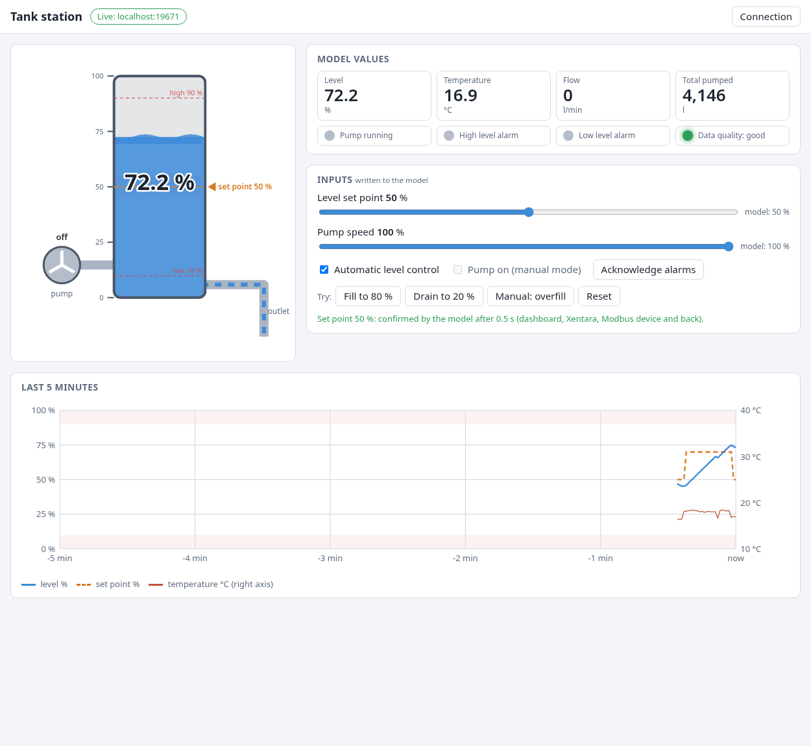

# Tank station dashboard

A web page that shows the Xentara model of the tank station and lets you change its inputs, so that you can see the effect: the water level, temperature, flow, pump and alarms update live, and every input you change goes through the whole chain (dashboard, Xentara, Modbus device, tank) and back.



Plain HTML, CSS and JavaScript: no build step, no framework, no CDN (it works on an offline machine). The browser talks **directly to Xentara's WebSocket interface**, like the Xentara Inspector does. The container only serves the files.

| File | What it is |
|---|---|
| `index.html`, `dashboard.css`, `dashboard.js` | the page: tank drawing, readings, inputs, trend |
| `xentara.js` | client for the Xentara WebSocket interface (token, hello, lookup, metadata, subscribe, write) |
| `cbor.js` | a small CBOR encoder and decoder (the protocol uses CBOR), tested against RFC 8949 and the API specification |
| `mock.js` | the demo: the same tank physics as the simulator, in the browser |
| `Containerfile`, `nginx.conf` | the container image (nginx on UBI 10 minimal, unprivileged, port 8080) |
| `test/` | unit tests (`node --test test/*.test.js`) and a live test against a real Xentara (`live_e2e.py`) |

## Try it without Xentara

Open `index.html` in a browser and press **Demo (no Xentara)**, or serve the folder and open `/?demo=1`:

```bash
python3 -m http.server 8091 --directory dashboard      # then http://localhost:8091/?demo=1
```

`?demo=1&speed=5` runs the simulated tank five times faster.

## Run it as a container

```bash
podman build --format docker -t xentara-dashboard -f Containerfile .      # the docker format keeps the HEALTHCHECK
podman run -d --name xentara-dashboard -p 8091:8080 xentara-dashboard      # http://<host>:8091
```

The image is about 150 MB, runs as a non-root user (also with an arbitrary user ID, as OpenShift assigns it), logs to stdout and sets a Content-Security-Policy that only allows its own scripts and connections to `https:` and `wss:`. `./lab.sh up` starts it together with Xentara and the simulator.

## Connect it to Xentara

The page connects to `<host the page was loaded from>:19670` by default; you can type another address. Four things have to be in place, and the page explains the first two when they are missing:

1. **The certificate.** Xentara's HTTP server uses a self-signed certificate. Open `https://<xentara>:19670` once in the browser and accept it.
2. **CORS.** The origin of the page must be in `httpServer.CORS.allowedOrigins` in Xentara's `config.json`, for example `"http://192.168.122.9:8091"` (scheme, host and port must match exactly; `http` and `https`, and an IP address and `localhost`, are different origins).
3. **Login.** A Xentara user with a password, and `"authentication": { "schemes": ["Bearer", "Basic"] }` in the `httpServer` section (the dashboard asks for a token with Basic authentication).
4. **Write access.** By default, remote clients may only read (and connect): every write is refused with `access denied (-32102)`. Give the user a role that may write, in `security.json` and `users.json`:

   ```json
   { "roles": [ { "name": "Operator", "UUID": "<uuid>" } ],
     "ACL": { "entries": [ { "role": "Operator", "allow": ["write"] } ] } }
   ```
   ```json
   { "users": [ { "UUID": "<uuid>", "userName": "admin", "roles": ["Operator"] } ] }
   ```

   Restart Xentara after changing these files. `./lab.sh init` creates all of this for the lab.

The model has to contain the data points of the `Plant` group (`xentara-lab/model/modbus-plant.json`): Tank Level, Temperature, Flow Rate, Total Volume, Pump Running, High Level Alarm, Low Level Alarm, Level Setpoint, Pump Speed, Pump Enable, Auto Mode and Alarm Acknowledge.

## What to try

- Move the **Level set point** slider: in automatic mode the pump switches on and off around the set point (a hysteresis of 5 %, shown as the shaded band) and the level follows. The message below the inputs shows how long the model took to confirm the change.
- Set **Pump speed** to 100 % and watch the flow and the level rise faster.
- Switch off **Automatic level control**, switch the pump on (**Manual: overfill**) and watch the high level alarm latch at 90 %. It stays on after the level drops until you press **Acknowledge alarms**.

## How it talks to Xentara

These details come from the WebSocket API specification and were checked against Xentara 2.1.1:

1. `POST https://host:19670/api/v1/request-token` with `Authorization: Basic ...` returns a token as **plain text** (valid for 20 seconds).
2. `wss://host:19670/api/ws?token=<token>`. Every message is one CBOR array of packets with integer-keyed maps: request `[0, id, opCode, {params}]`, success `[1, id, result]`, error `[2, id, {0: code, 1: message}]`, event `[8, 0, {0: time, 1: element UUID, 2: {attribute: 121(value)}}]`.
3. `client hello` (op 14), then for each data point `lookup` (op 3, primary key `Plant.<name>` to element UUID), `metadata` (op 2, to learn the data type of the value), and one `subscribe` (op 6) for the value (attribute 11) and quality (attribute 9). The answer is followed by an event with the current values.
4. `write` (op 5) sends the value as the attribute's data type: a float attribute gets a CBOR float even for a whole number such as 70, an integer attribute gets an integer, a boolean attribute gets a boolean.

## Tests

```bash
node --test test/*.test.js                       # 23 tests: the CBOR codec, and the client against a fake Xentara
pip install websockets
python3 test/live_e2e.py "http://127.0.0.1:8091/" localhost:19670 admin ~/password.txt shot.png   # needs a running Xentara
```

The live test (headless Chrome through the DevTools protocol) logs in, checks the 11 data points, writes every input and prints whether the model confirmed it. It passed against Xentara 2.1.1 on RHEL 10 with the simulator on another machine: all writes were confirmed after about 0.5 s, and the Modbus device received the matching register and coil writes.
